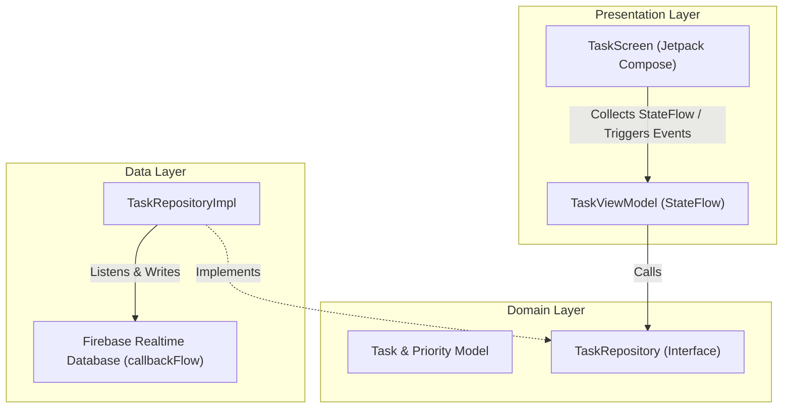

# Reactive To-Do List Android Application

A reactive To-Do List Android app built using **Jetpack Compose**, **Clean Architecture**, **Kotlin Coroutines (callbackFlow)**, and **Firebase Realtime Database**.

---

## 🏛 Clean Architecture Overview

---

## 📂 Source Code Structure

- **Domain / Models**:
  - [`Priority.kt`](app/src/main/java/com/example/todo/model/Priority.kt): Enum with `HIGH`, `MEDIUM`, and `LOW` levels.
  - [`Task.kt`](app/src/main/java/com/example/todo/model/Task.kt): Task entity (`id`, `description`, `priority`, `timestamp`) with `DataSnapshot.toTask()` and `Task.toMap()` Firebase mapping functions.
  - [`TaskRepository.kt`](app/src/main/java/com/example/todo/domain/repository/TaskRepository.kt): Clean architecture domain repository interface.

- **Data Layer**:
  - [`TaskRepositoryImpl.kt`](app/src/main/java/com/example/todo/data/repository/TaskRepositoryImpl.kt): Repository implementation using `callbackFlow` with Firebase's `ValueEventListener` and coroutine `await()` for CRUD operations (`addTask`, `updateTask`, `deleteTask`).

- **Presentation Layer**:
  - [`TaskUiState.kt`](app/src/main/java/com/example/todo/presentation/TaskUiState.kt): State container for tasks, loading states, and messages.
  - [`TaskViewModel.kt`](app/src/main/java/com/example/todo/presentation/TaskViewModel.kt): ViewModel exposing reactive `StateFlow<TaskUiState>`.
  - [`TaskScreen.kt`](app/src/main/java/com/example/todo/presentation/ui/TaskScreen.kt): Jetpack Compose Material 3 UI for displaying, creating, editing, and deleting tasks.